<p align="center"></p>

# BullScope: Indian Stock Market, F&O, Mutual Fund & Crypto Analytics (Power BI · Tableau · Python)

**Which shares are being bought and sold, how the option chain looks for the next expiry, and which mutual funds have earned their place in a portfolio.**

An end-to-end market analytics project on real Indian market data: **51 NIFTY 50 stocks (NSE + BSE prices), 11 indices, 80 mutual funds** (plus live search of all ~38,000 AMFI schemes) with daily history since **January 2023** (funds: 5 years). Live news, market videos and crypto prices come in as you use it. Prices refresh every weekday after market close. The same star-schema dataset feeds three front ends:

| | What | Where |
|---|---|---|
| 🌐 | **Live web dashboard**: 12 pages, global search (Ctrl K), 7 themes incl. Gold & Black, any date range, works on phones | **[Open the dashboard](https://rahulsuryvanshi810.github.io/bullscope/)** · `docs/` |
| 📊 | **Power BI project** (`powerbi/BullScope/BullScope.pbip`): 10-table model, **77 DAX measures**, 4 report pages | [`powerbi/`](powerbi/) |
| 📈 | **Tableau workbook** (`tableau/BullScope.twb`): 47,777-row daily dataset, 11 calculated fields (LOD + table calcs), 3 parameters | [`tableau/`](tableau/) |
| 🐍 | **Python pipeline**: data download, analytics, ML, Monte Carlo, news collector, 12 tests, scheduled GitHub Actions refresh | `scripts/`, `tests/` |

**▶ [Watch the 80-second demo video](reports/video/bullscope_demo.mp4)** (1080p, captions, no sound needed)

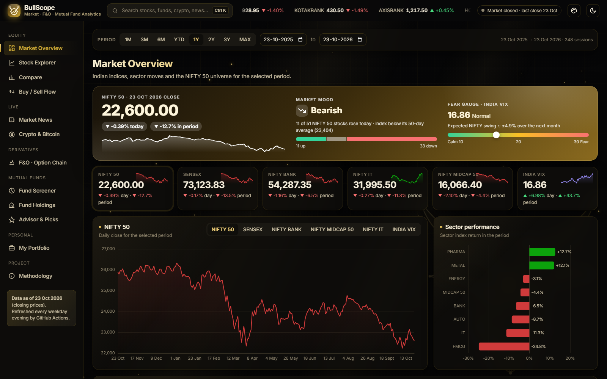

| Market news: top stories, videos, "for you" | Crypto & Bitcoin: live prices, Fear & Greed |
|---|---|
| 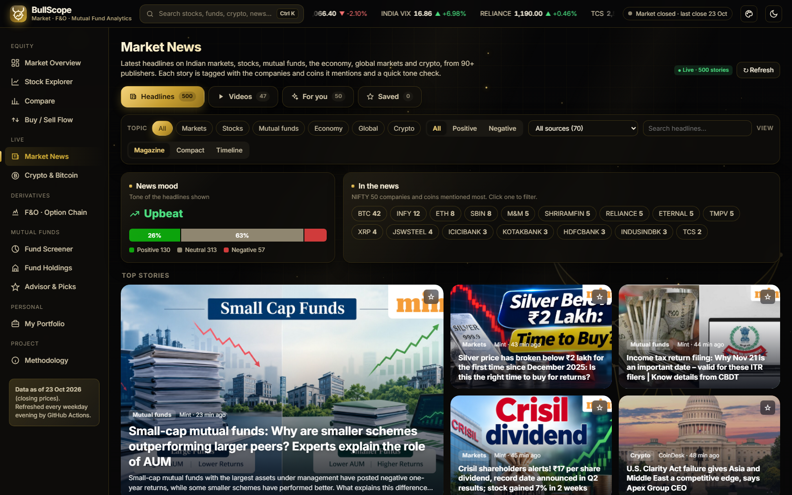 | 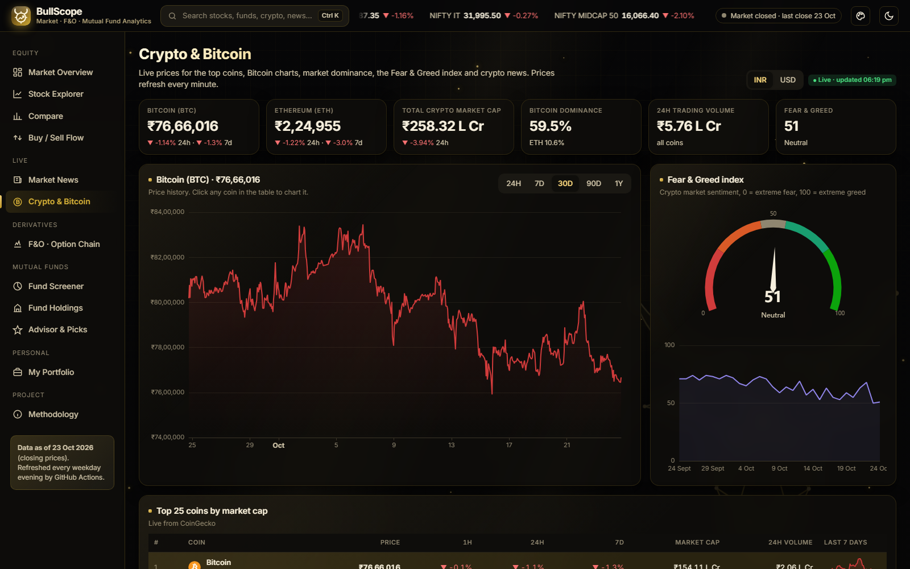 |
| **Stock explorer** | **Compare: growth, correlation, risk** |
| 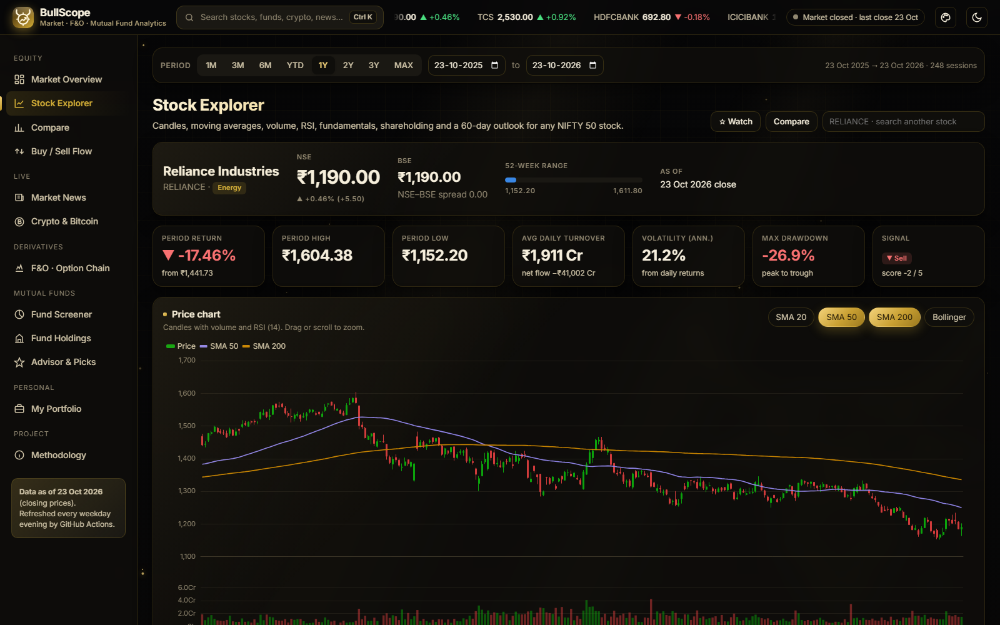 | 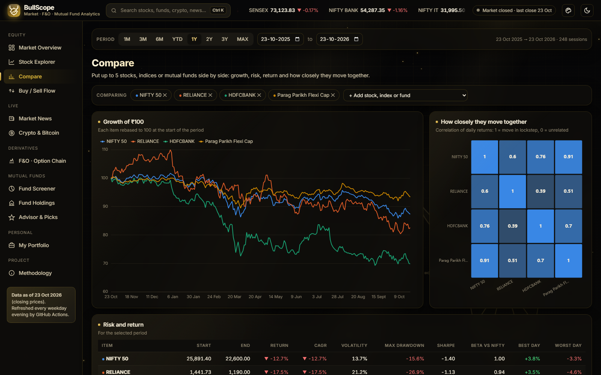 |
| **Buy / sell flow and FII / DII** | **F&O option chain and strategy builder** |
| 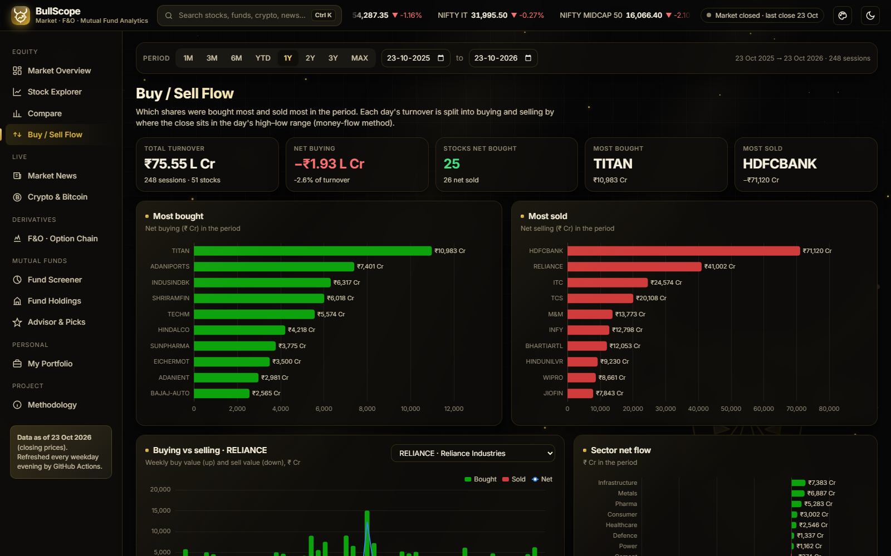 | 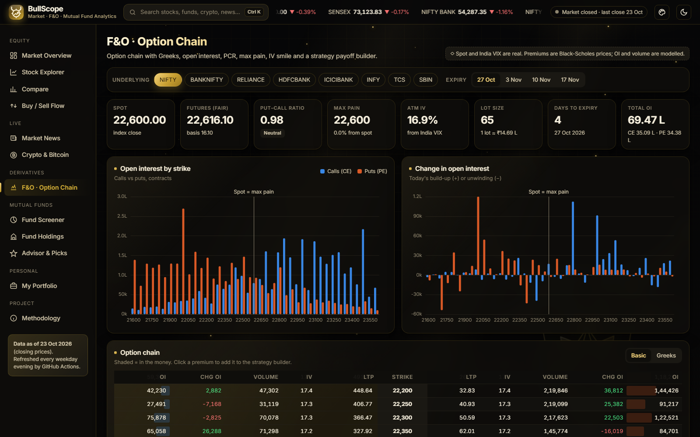 |
| **Mutual fund screener** | **Fund holdings: who owns what stake** |
| 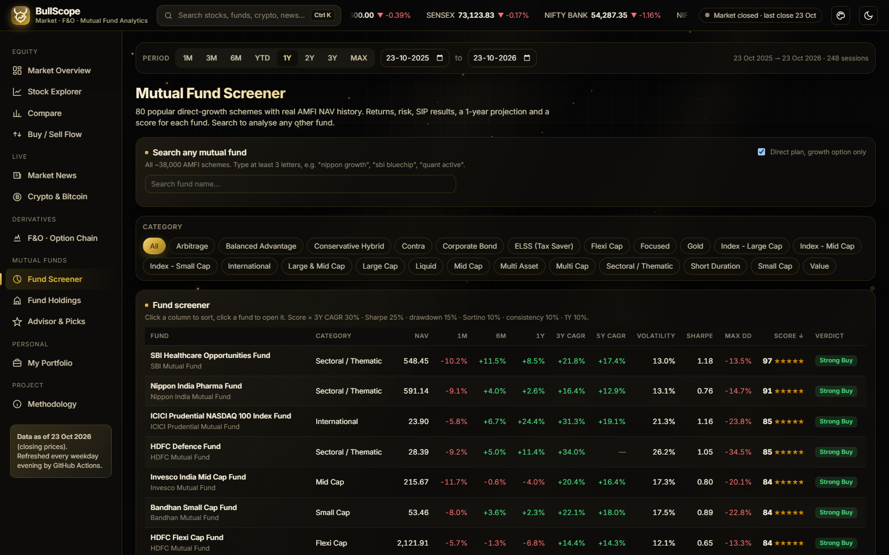 | 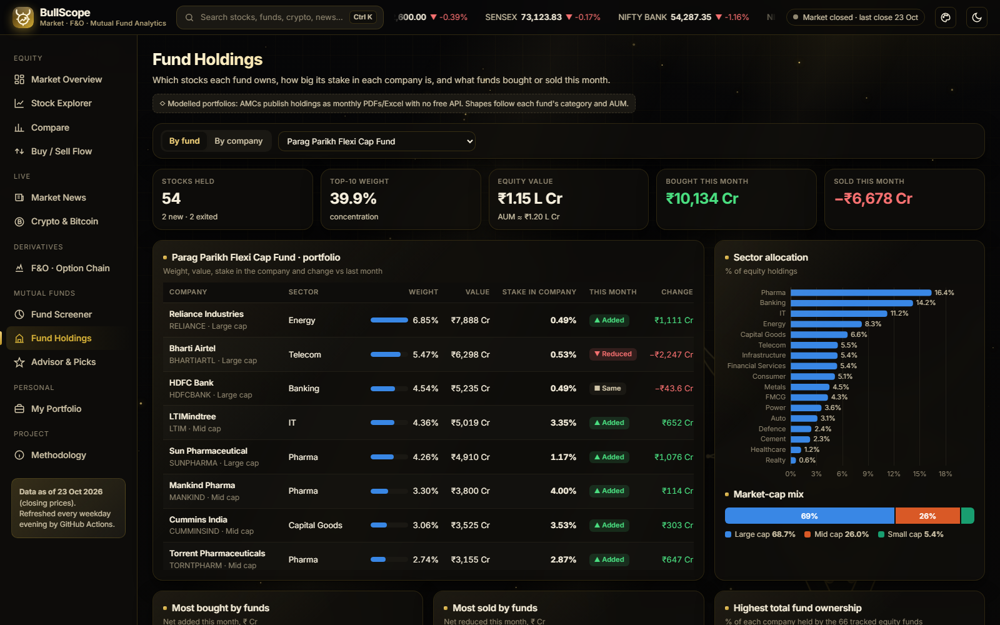 |
| **Advisor: model portfolio and goal planner** | **On a phone** |
| 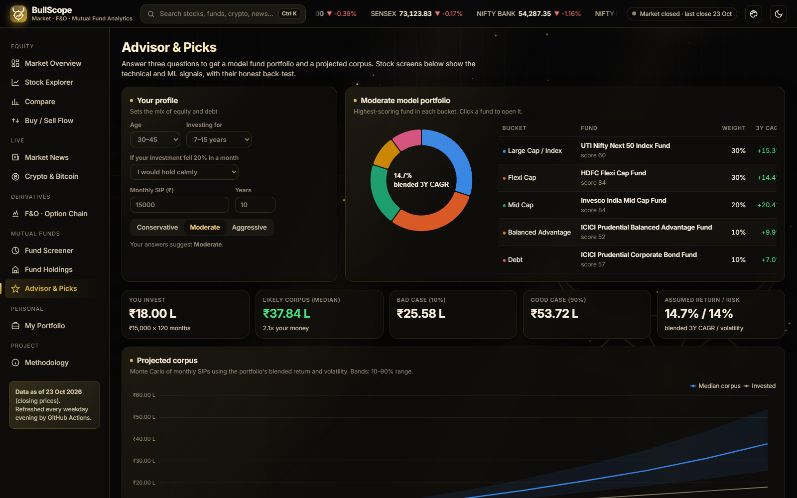 | 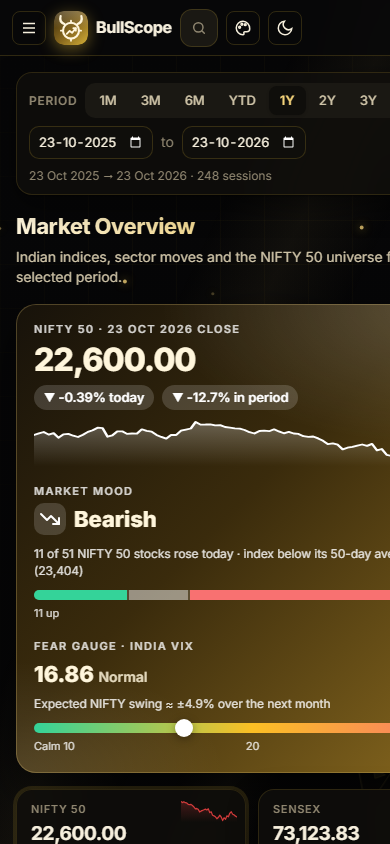 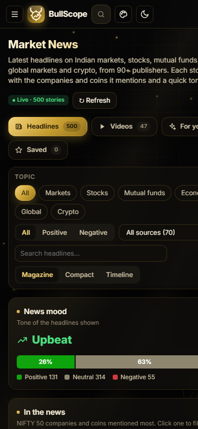 |

---

## What the dashboard does

| Page | Features |
|---|---|
| **Market Overview** | NIFTY 50, SENSEX, NIFTY BANK, IT, Midcap and India VIX tiles; index chart; sector returns; market-cap **heatmap** of all 51 stocks; top gainers, losers and most active; **multiple watchlists** (My Watchlist, Long Term, Trading, Dividend, or your own) **with price alerts**; **seasonality heatmap** (return by year × month, with monthly averages); stocks nearest their **52-week high / low** |
| **Compare** | Up to 5 stocks, indices or mutual funds side by side: growth of ₹100, a **correlation heatmap** (how closely they move together), drawdown chart, and a risk/return table (CAGR, volatility, max drawdown, Sharpe, beta, best and worst day) |
| **Stock Explorer** | Search any stock. **NSE and BSE price** side by side with the spread; candlesticks with SMA 20/50/200 and Bollinger bands; volume; RSI; fundamentals (P/E, P/B, ROE, beta…); **shareholding split** (promoters / institutions / public); 5-rule technical score; ML probability of a rise; **60-session Monte Carlo price range**; sector peers |
| **Buy / Sell Flow** | **Most bought and most sold shares** in any period (₹ Cr), weekly buying vs selling for one stock, sector net flow, volume shockers, a full flow table, and **FII / DII** net investment |
| **Market News** | Four tabs: **Headlines**, **Videos** (latest market videos from CNBC-TV18, CNBC Awaaz, Moneycontrol, NDTV Profit, Business Today, CoinDesk and Coin Bureau, played inside the dashboard), **For you** (only news about your watchlist, portfolio and compared stocks) and **Saved** (bookmarks kept in your browser). Three views: **Magazine** (top stories with big photos), **Compact** and **Timeline** (grouped by hour); filter by publisher. Latest headlines from 90+ publishers (Economic Times, Mint, Business Standard, Moneycontrol, CNBC TV18, CoinDesk, Cointelegraph and more via Google News): filter by topic (markets, stocks, mutual funds, economy, global, crypto), tone (positive / negative) or search; **"In the news"** shows which NIFTY 50 companies and coins are mentioned most; a news-mood bar; headlines also appear on Overview and on each stock's page. **Live** when opened with `serve.py` (refreshes every 5 minutes), otherwise a snapshot refreshed every 30 minutes by GitHub Actions |
| **Crypto & Bitcoin** | **Live** prices (refresh every minute) in INR or USD for the top 25 coins with 1h / 24h / 7d change and 7-day sparklines; Bitcoin dominance, total market cap and volume; price chart for any coin (24H to 1Y); **Fear & Greed** gauge and 30-day history; **Bitcoin vs NIFTY 50 vs Gold** over a year; crypto headlines |
| **F&O · Option Chain** | NIFTY (weekly expiries), BANKNIFTY and 6 stocks. Full chain with OI, change in OI, volume, IV, premium and **Greeks**; **PCR, max pain**, ATM IV, lot size; OI and change-in-OI charts; IV smile; PCR trend; **strategy builder** with 8 presets (straddle, strangle, iron condor, spreads…) showing payoff, max profit/loss, breakevens and chance of profit |
| **Fund Screener** | 80 funds across large, large & mid, mid, small, flexi, multi, focused, ELSS, value, contra, index, sectoral, hybrid, gold, international, liquid and debt. **Search any of the ~38,000 AMFI schemes by name** and it is analysed live in the browser with the same metrics and score. 1M–5Y returns, CAGR, volatility, Sharpe, Sortino, max drawdown, beta, rolling returns, a **0–100 score with stars and a Buy / Hold / Review verdict**; growth-of-₹100 vs NIFTY with up to 3 funds compared; **SIP calculator on real NAVs with XIRR**; 12-month Monte Carlo projection; **live NAV button** (calls AMFI data in the browser) |
| **Fund Holdings** | Pick a fund: every stock it holds, weight, value, **% stake in the company**, and what it added or cut this month. Pick a company: **which funds hold it and how big each stake is**. Market-wide lists of the stocks funds bought and sold most |
| **Advisor & Picks** | 3-question risk profile → Conservative / Moderate / Aggressive **model portfolio** using the top-scored fund in each bucket, and a projected SIP corpus (10th–90th percentile). A **goal planner** works out the monthly SIP needed for a target (adjusted for inflation) and the chance of reaching it. A stock screen with signals, plus the honest back-test of those signals |
| **My Portfolio** | Add your own shares and mutual funds (saved only in your browser; export/import as JSON). Shows current value, invested amount, profit/loss, last-day change, weights, stocks-vs-funds mix and sector allocation; risk (volatility, beta, Sharpe, max drawdown, 1-day value at risk); a diversification score; a **12-month prediction** that replays real days from the last 3 years so holdings keep their real correlations; and **suggestions** (concentration, sector overweight, sell signals, weak funds with a stronger alternative in the same category) |
| **Connect demat** (on My Portfolio) | **File import** for Zerodha, Groww, Upstox, Angel One or any broker (XLSX/CSV, read in the browser, never uploaded) and **live sync** for Zerodha (Kite Connect), Upstox and Angel One through `connector/`, a helper that runs only on your PC: you log in on the broker's own page, tokens stay in memory, read-only. See [`connector/README.md`](connector/README.md) |
| **Everywhere** | **Global search** (Ctrl K or /): stocks, all mutual funds incl. live AMFI search, indices, coins, headlines and pages · **🎨 7 backgrounds**: Gold & Black (default), Market Waves, Candlesticks, Data Network, Aurora, Sunset, Clean · light / dark mode · loading placeholders, keyboard focus outlines, phone layout |
| **Methodology** | Every source, formula and assumption, including which data is modelled |

## Key findings (data to 23 Oct 2026)

| # | Question | Answer |
|---|---|---|
| 1 | How has the market done? | NIFTY 50 is **−12.7% over 1 year** (22,600 vs a 26,329 high in the period) but **+17.2% over 3 years**. SENSEX −13.5% / +13.2%. |
| 2 | Which sectors led? | **Pharma +12.7%** and **Metal +12.1%** were the only sector indices up over the year. **FMCG −24.8%** and IT −11.3% were worst. Over 3 years Metal (+77%) and Pharma (+70%) lead; FMCG is −17%. |
| 3 | What were the biggest one-year moves? | Gainers: Tech Mahindra **+26.5%**, Shriram Finance +23.3%. Losers: Trent −42.9%, ITC −35.0%, Jio Financial −33.5%. |
| 4 | Which funds score best? | Overall: **SBI Healthcare Opportunities (97)** and **Nippon India Pharma (91)**, riding the pharma rally. Best by category: Flexi Cap **HDFC Flexi Cap (84, 3Y CAGR 14.4%)**, Mid Cap **Invesco India Mid Cap (84, 20.4%)**, Small Cap **Bandhan Small Cap (84, 22.1%)**, Large Cap **Bandhan Large Cap (59, 12.1%)**. |
| 5 | What do model portfolios imply? | Blended 3Y CAGR of the top-scored fund mix: Conservative **10.3%**, Moderate **14.7%**, Aggressive **19.6%**. The Advisor page turns this into a projected SIP corpus with a 10th–90th percentile range. |
| 6 | Can technical signals or ML predict the next month? | **No, not reliably.** Over 7,300 back-tested signals, "Strong Buy" rose over the next 20 sessions 55.7% of the time vs 55.6% for "Strong Sell". The ML models scored **AUC 0.51 and 0.49** on unseen data (0.50 = coin toss). The dashboard shows this test next to every signal. |

## Data

| Data | Source | Real or modelled |
|---|---|---|
| Market and crypto news | RSS feeds of Indian and global publishers, Google News | Real (headlines link to the publisher) |
| Crypto prices, market data, Fear & Greed | CoinGecko, alternative.me (live in the browser) | Real |
| Daily OHLCV for 51 NIFTY 50 stocks (NSE), latest BSE close | Yahoo Finance (`.NS`, `.BO`) | Real |
| 11 indices incl. SENSEX, NIFTY BANK, sector indices, India VIX | Yahoo Finance | Real |
| Market cap, P/E, P/B, EPS, ROE, beta, promoter / institution holding | Yahoo Finance | Real |
| NAV history of 80 direct-growth mutual funds, plus any fund searched on the page | AMFI via [mfapi.in](https://www.mfapi.in/) | Real |
| Buy vs sell split of turnover | Derived from real OHLCV (money-flow method) | Estimated |
| Option premiums and Greeks | Black-Scholes on real spot, IV from India VIX / realised volatility | Model prices |
| Option OI, change in OI, volume | Modelled around spot | **Modelled** |
| FII / DII daily flows | Modelled from real NIFTY moves | **Modelled** |
| Fund portfolio holdings and stakes | Modelled from each fund's category and AUM | **Modelled** |

NSE's live APIs (option chain, FII/DII history, bulk deals) block automated access, and AMCs publish holdings only as monthly factsheets, so those parts are modelled and labelled as such on every page. Yahoo does not adjust for demergers, so the Tata Motors demerger (Oct 2025) is adjusted in the build; any remaining one-day move above 25% is listed on the Methodology page.

## Data model (star schema)

```
                     Date ──────────────┬───────────────┬──────────────┐
                       │                │               │              │
Stocks ──► Stock Prices        Index Prices        Fund NAV ◄── Funds ──► Fund Holdings ◄── Stocks
  (51)      (47,777 rows,        (10,293)          (151,934)      (80)        (2,773, modelled)
            OHLCV, turnover,
            buy / sell value)                FII DII (939, modelled)     Option Chain (1,690, modelled)
```

| Table (`data/processed/`) | Rows | Grain |
|---|---|---|
| `fact_stock_prices.csv` | 47,777 | stock × trading day: OHLCV, daily return, turnover, buy and sell value (₹ Cr) |
| `dim_stock.csv` | 51 | stock: sector, fundamentals, shareholding, BSE close, signal, ML probability, Monte Carlo outlook |
| `fact_index_prices.csv` | 10,293 | index × day |
| `dim_fund.csv` | 80 | fund: category, returns, risk metrics, SIP XIRR, score, verdict |
| `fact_fund_nav.csv` | 151,934 | fund × day since 2019 |
| `fact_fund_holdings.csv` | 2,773 | fund × stock: weight, value, stake %, change vs last month |
| `fact_option_chain.csv` | 1,690 | underlying × expiry × strike × CE/PE |
| `fact_fii_dii.csv` | 939 | day: FII and DII buy, sell, net |
| `dim_date.csv`, `signal_backtest.csv` | | calendar; signal back-test |

## Methods

- **Buy / sell split**: turnover × (1 + CLV) / 2 with CLV = ((close − low) − (high − close)) / (high − low).
- **Technical score (−5 to +5)**: price vs 50-DMA, 50-DMA vs 200-DMA (golden cross), MACD histogram, RSI < 30 / > 70, 3-month momentum ±5%.
- **ML**: logistic regression and gradient boosting on 10 features (RSI, MACD, moving-average gaps, momentum, volatility, distance from 52-week high, volume ratio). Walk-forward split with a 20-session gap so no future data leaks into training.
- **Monte Carlo**: 3,000 paths by resampling real daily log returns (1 year for stocks, 3 years for funds).
- **Fund score**: percentile rank within the same asset class (equity, hybrid, debt, gold & international): 3Y CAGR 30%, Sharpe 25%, max drawdown 15%, Sortino 10%, share of positive rolling 1-year windows 10%, 1Y return 10%.
- **SIP XIRR**: monthly instalments on the first NAV date of each month, solved by bisection.
- **Options**: Black-Scholes with a volatility skew; max pain = strike that minimises option buyers' total payoff; chance of profit from a lognormal at ATM IV.

## Run it

**Quickest way to open it:** double-click `Start BullScope.bat` (or run `python serve.py`). It opens the dashboard with live news at http://127.0.0.1:8765.

```bash
pip install -r requirements.txt
cd scripts
python fetch_data.py        # download prices, indices, fundamentals and NAVs (needs internet, ~2 min)
python build_dataset.py     # analytics, ML, Monte Carlo, modelled tables -> data/processed + docs/data.js
python build_bi_files.py    # Power BI project, Power Query file, Tableau workbook
cd .. && python -m pytest   # 8 data-quality tests
python fetch_news.py      # (from scripts/) latest headlines -> docs/news.json
python serve.py           # dashboard with live news at http://127.0.0.1:8765
```

`.github/workflows/refresh-data.yml` runs the same pipeline every weekday at 18:30 IST and commits the new data, so the live dashboard stays current.

## Repository layout

```
connector/    bullscope_connector.py: local helper for Zerodha / Upstox / Angel One holdings sync
scripts/      fetch_data.py · build_dataset.py · build_bi_files.py · config.py · holdings_universe.py
data/raw/     downloaded CSVs        data/processed/  star-schema tables for BI
docs/         web dashboard (index.html, app.js, styles.css, data.js), served by GitHub Pages
powerbi/      PBIP project, measures.dax, power_query.m, theme, guide
tableau/      .twb workbook, stocks_flat.csv, calculated fields, guide
reports/      screenshots       tests/  data-quality tests
```

**Tools:** Python (pandas, NumPy, SciPy, scikit-learn, yfinance), ECharts, Power BI (DAX, Power Query, TMDL), Tableau, GitHub Actions.

> Educational project, not investment advice. Mutual fund investments are subject to market risks. Not affiliated with NSE, BSE, AMFI or any AMC.
